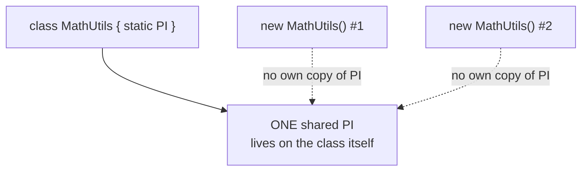

# TypeScript Class, Readonly, Optional & Static Members — Guide

---

## 1. Class

- A **blueprint** for creating objects that share the same properties and methods.

```typescript
class Person {
  name: string;
  constructor(name: string) {
    this.name = name;
  }
  greet() {
    console.log(`Hello, ${this.name}`);
  }
}

const p1 = new Person("Pavan");
p1.greet(); // Hello, Pavan
```

### The order things actually run in, when `new` is called

- It's easy to assume the constructor body is the very first thing that runs — it isn't quite. The real order is:
  1. If the class `extends` another, `super()` runs first (covered in the Inheritance guide).
  2. **Field initializers** run next — any property given a default value directly in the class body (e.g. `name: string = "default"`), in the order they're written.
  3. **Then** the rest of the constructor body runs.

```typescript
class Example {
  a = console.log("field a initialized") as any;
  constructor() {
    console.log("constructor body running");
  }
}
new Example();
// Output order:
// "field a initialized"
// "constructor body running"
```

- Why this matters: if a field's default value depends on something only set up later in the constructor, the field will initialize using an outdated or `undefined` value, since it runs *before* the constructor body gets a chance to set anything up.

### Why class declarations aren't hoisted the way function declarations are

- A `function` declaration is fully hoisted — it can be called before its line in the code (covered in the Loops/Variables guides). A `class` declaration behaves more like `let`/`const` — it's hoisted in name only, but stays in the **temporal dead zone** until its declaration line actually runs.

```typescript
const x = new Animal(); // ❌ Error — cannot access 'Animal' before initialization
class Animal {}
```
- This is intentional: classes often have complex setup logic (like extending another class), and allowing them to be used before that logic runs would risk using a half-defined class.

### A common practical trap: losing `this` when a method is passed around

- If a class method is passed elsewhere as a plain reference — like a callback — `this` inside it is no longer guaranteed to refer to the original instance, because `this` depends on **how the function is called**, not where it was defined.

```typescript
class Button {
  label = "Click me";
  handleClick() {
    console.log(this.label); // relies on 'this'
  }
}

const btn = new Button();
setTimeout(btn.handleClick, 1000); // ❌ 'this' is now undefined/wrong here
```

- The common fix is declaring the method as an **arrow function class field** instead of a regular method — since arrow functions don't have their own `this`, they permanently capture `this` from the surrounding class instance at the moment they're created, regardless of how they're later called.

```typescript
class Button {
  label = "Click me";
  handleClick = () => {
    console.log(this.label); // 'this' is locked to the instance, always
  };
}
```

---

## 2. Read-only Properties

- Prevents a property from being reassigned after it's been initialized, using the `readonly` keyword.

```typescript
class Car {
  readonly brand: string;
  constructor(brand: string) {
    this.brand = brand;
  }
}

const car = new Car("Toyota");
// car.brand = "Honda"; // ❌ Error: Cannot assign to 'brand' because it is a read-only property.
```

### Why is a `readonly` property still allowed to be set inside the constructor?

- `readonly` doesn't mean "set it once, ever" in an absolute sense — it means **"only during the object's own initialization."** The constructor is considered part of that initialization process, so assigning it there is allowed. Any assignment attempted **after** the object is fully constructed is what actually gets blocked.
- This is why `readonly brand: string;` followed by `this.brand = brand;` inside the constructor works fine, but trying `car.brand = "Honda"` from outside, afterward, does not.

### The same compile-time-only limitation applies here too

- Just like with interfaces (covered separately), `readonly` on a class property is a **compile-time-only** restriction. It exists purely for the type checker — once compiled to plain JavaScript, nothing stops the property from being reassigned at runtime through code that bypasses TypeScript's checks (like `as any`).
- And just like with plain objects, `readonly` only locks the **property binding itself** — if the property's value is an object or array, its internal contents can still be freely modified; only reassigning the property to a *different* object/array is blocked.

```typescript
class Config {
  readonly settings: { theme: string } = { theme: "dark" };
}
const c = new Config();
c.settings.theme = "light"; // ✅ allowed — mutating contents, not reassigning the property
// c.settings = { theme: "light" }; // ❌ blocked
```

---

## 3. Optional Properties

- Marks a property as **not required** when creating an object, using `?`.

```typescript
class Student {
  name: string;
  age?: number;

  constructor(name: string, age?: number) {
    this.name = name;
    if (age) this.age = age;
  }
}

const s1 = new Student("Pavan");
const s2 = new Student("Kiran", 22);
```

### What an optional property's type actually becomes

- `age?: number` doesn't just mean "might be missing" in a vague sense — TypeScript's actual, concrete type for `age` becomes `number | undefined`. Accessing it without checking (`s1.age.toFixed()`, for example) is flagged as a possible error, since the compiler genuinely accounts for the `undefined` case everywhere the property is used.

### Optional property vs a property with a default value — two different strategies

- `age?: number` — the property might not exist at all on the object; it stays `undefined` unless explicitly set.
- `age: number = 0` — the property **always** exists and always has a real `number` value; if nothing is passed in, it falls back to a default rather than being missing.
- Choosing between them is a design decision: use `?` when "not applicable" is a genuinely meaningful, distinct state from having a real value; use a default when there should always be a usable value, even if the caller doesn't provide one.

### The `strictPropertyInitialization` rule — why TypeScript forces you to think about this

- With TypeScript's strict mode enabled, **every class property must be guaranteed a value** — either by assigning it in the constructor, giving it a default value at declaration, or explicitly marking it optional (`?`). A property typed as `number` but genuinely left unassigned is flagged as a compile error.

```typescript
class Student {
  age: number; // ❌ Error under strict mode — never guaranteed to be assigned
}
```

- This exists specifically to prevent a common real bug: code elsewhere confidently treating a property as always having a value (because its type says `number`, not `number | undefined`), when in reality it could still be `undefined` at runtime if nothing ever set it. Marking it `age?: number` (or assigning a default) is TypeScript's way of forcing that possibility to be handled honestly in the type itself.

---

## 4. Static Properties and Methods

- **Static members belong to the class itself**, not to individual instances — accessed through the class name directly, never through an object created from it.

```typescript
class MathUtils {
  static PI = 3.14;
  static square(num: number): number {
    return num * num;
  }
}

console.log(MathUtils.PI);       // 3.14
console.log(MathUtils.square(5)); // 25
```

### Why do static members "belong to the class, not instances" — what's actually happening?

- A regular (instance) property lives on each individual object created by `new` — every instance gets its **own separate copy** in memory.
- A static member instead lives directly on the **class itself** (technically, on the class's underlying constructor function) — there is only **one copy**, shared by the entire class, no matter how many instances get created.



- This is exactly why static members are a natural fit for **shared constants** or **utility functions** that don't depend on any particular instance's data — there's genuinely only one sensible version of `PI` or `square()` that should exist, regardless of how many objects you create.

### Why can't a static method use `this` to access instance properties?

- A static method is called on the class itself, without any specific instance ever being involved — so there's no particular object's data for `this` to meaningfully point to inside it. Using `this.someInstanceProperty` inside a static method is a compile error, because that property genuinely doesn't exist at the class level, only on individual instances.

```typescript
class Counter {
  count = 0;              // instance property
  static increment() {
    // this.count++;      // ❌ Error — no instance exists here
  }
}
```

### A real-world pattern: Singleton, built from `static` + a `private`/`protected` constructor

- Combining a static property with a restricted constructor is the standard way to implement the **Singleton pattern** — guaranteeing a class can only ever have exactly **one** instance in the entire program.

```typescript
class Database {
  private static instance: Database;
  private constructor() { /* setup logic */ }

  static getInstance(): Database {
    if (!Database.instance) {
      Database.instance = new Database();
    }
    return Database.instance;
  }
}

const db1 = Database.getInstance();
const db2 = Database.getInstance();
console.log(db1 === db2); // true — always the same single instance
```
- The `private constructor` blocks anyone from bypassing the pattern with `new Database()` directly, forcing everyone to go through `getInstance()`, which controls creation and guarantees only one instance ever exists.

### `static readonly` — a common combination for true constants

- Combining both modifiers creates a value that's **shared across the whole class** and **can never be reassigned** after its initial value — the typical way to represent genuine constants tied to a class.

```typescript
class Circle {
  static readonly MAX_RADIUS = 1000;
}
```

---

## Q&A

**Q1. What actually runs first when a `new` object is created — the constructor body, or a field's default value initializer?**

A:
- If the class extends another, `super()` runs first.
- Field initializers (default values assigned directly in the class body) run next, in the order they're written.
- The rest of the constructor body runs after that.

**Q2. Why isn't a class declaration hoisted the same way a function declaration is?**

A:
- A class declaration is hoisted in name only — it stays in a "temporal dead zone" until its declaration line actually executes, similar to `let`/`const`.
- Using it before that line throws an error, rather than silently returning `undefined` the way an unassigned `var` would.
- This is intentional, since classes often have complex setup (like extending another class), and allowing early use could mean working with a half-defined class.

**Q3. Why does a class method sometimes "lose" its correct `this` when passed around as a callback, and how is this usually fixed?**

A:
- `this` depends on how a function is actually called, not where it was originally defined — passing a method as a bare reference (like to `setTimeout`) detaches it from the instance it came from.
- The common fix is declaring the method as an arrow function class field instead of a regular method, since arrow functions permanently capture `this` from the surrounding instance at creation time, regardless of how they're later called.

**Q4. Why is a `readonly` property still allowed to be assigned inside the constructor, but not afterward?**

A:
- `readonly` means "only during the object's own initialization," not "never, under any circumstance."
- The constructor is considered part of that initialization process, so assigning the property there is allowed.
- Any assignment attempted after the object has finished being constructed is what's actually blocked.

**Q5. Does `readonly` on a class property provide any protection once the code is compiled to JavaScript?**

A:
- No — it's a compile-time-only restriction enforced by the TypeScript type checker.
- Once compiled, nothing in the plain JavaScript output stops the property from being reassigned, especially through code that bypasses TypeScript's checks.

**Q6. If a `readonly` property holds an object, can its internal contents still be changed?**

A:
- Yes — `readonly` only locks the property binding itself, preventing it from being reassigned to a different object or array.
- The object's internal properties remain fully mutable, since mutating them doesn't change what the `readonly` property itself points to.

**Q7. What is the actual type of an optional class property, and what practical problem does marking something optional (instead of giving it a default) help avoid?**

A:
- An optional property (`age?: number`) is actually typed as `number | undefined`, not just `number`.
- This forces every place that uses the property to account for the possibility that it's missing, rather than assuming a value always exists.
- It helps avoid the common bug of code confidently treating a property as always present when it might genuinely be absent.

**Q8. What's the difference between making a property optional (`age?: number`) and giving it a default value (`age: number = 0`)?**

A:
- An optional property might not exist at all on the object — it stays `undefined` unless explicitly assigned.
- A property with a default value always exists and always holds a real value, falling back to the default if nothing is provided.
- The choice depends on whether "not applicable" is a meaningful distinct state, versus always needing a usable value.

**Q9. What does the `strictPropertyInitialization` rule enforce, and why does it exist?**

A:
- Under strict mode, every class property must be guaranteed a value — through constructor assignment, a default value, or being marked optional.
- It exists to prevent code from confidently treating a property as always having a value (based on its declared type) when in reality it could still be `undefined` at runtime because nothing ever assigned it.

**Q10. Why do static members only have one shared copy across the entire class, rather than one copy per instance?**

A:
- A regular (instance) property lives on each individual object created by `new`, so every instance gets its own separate copy.
- A static member instead lives directly on the class itself, not on any instance — so there's only ever one copy, shared by the whole class regardless of how many instances exist.

**Q11. Why can't a static method access instance properties through `this`?**

A:
- A static method is called on the class itself, without any specific instance being involved in that call.
- Since there's no particular instance's data to work with, `this` inside a static method has no meaningful instance context to point to, so accessing instance-only properties through it is a compile error.

**Q12. How would you implement a Singleton pattern in TypeScript, and why is a `private` constructor necessary for it?**

A:
- Combine a static property that holds the single instance with a static method (like `getInstance()`) that creates the instance only if it doesn't already exist, otherwise returning the existing one.
- A `private` constructor is necessary to block any code from bypassing this pattern by calling `new ClassName()` directly from outside — forcing all creation to go through the controlled `getInstance()` method.

**Q13. In a real project, when would `static readonly` be the right choice over a regular `readonly` instance property?**

A:
- Use `static readonly` when the constant value is the same for every instance of the class and doesn't depend on any particular object's data — like a maximum limit or a fixed configuration value tied to the class as a whole.
- Use a regular (instance-level) `readonly` property when the value is set once per object but can genuinely differ between different instances.
