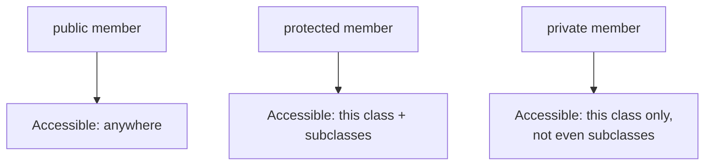

# TypeScript Inheritance, super(), Overriding & Access Modifiers — Guide

---

## 1. Inheritance

- Lets a **child class** acquire the properties and methods of a **parent class**, using the `extends` keyword.

```typescript
class Animal {
  eat() {
    console.log("Animal eats food");
  }
}

class Dog extends Animal {
  bark() {
    console.log("Dog barks");
  }
}

const d = new Dog();
d.eat();  // inherited from Animal
d.bark(); // defined on Dog itself
```

### Why can a class only `extends` one other class?

- When `Dog extends Animal`, TypeScript links the two classes into a **prototype chain** — a simple, linear path the JavaScript engine walks up whenever it looks for a method or property that isn't found directly on the object.


- If a class could `extend` **two** parent classes at once, and both parents happened to define a method with the same name, there'd be no clear rule for which version the child should get — this is often called the **"diamond problem."**
- Rather than invent complicated rules to resolve that ambiguity, JavaScript (and TypeScript along with it) keeps inheritance strictly **single-path** — one parent only. If a class genuinely needs behavior from multiple sources, the common solution is **composition** instead: building the class out of smaller, separate helper objects/classes it uses internally, rather than trying to inherit from several parents at once. Composition is often considered the more flexible, less fragile choice even when multiple inheritance *is* technically available in a language.

---

## 2. `super()`

- Used inside a child class's constructor to call the **parent class's constructor**.

```typescript
class Animal {
  constructor(public name: string) {}
}

class Dog extends Animal {
  constructor(name: string, public breed: string) {
    super(name); // calls Animal's constructor
  }
}
```

### Why must `super()` be called before using `this` in the child constructor?

- In a plain JavaScript/TypeScript class hierarchy, the **parent's constructor is actually responsible for initially setting up `this`** — the object doesn't fully exist yet, from the child constructor's point of view, until the parent constructor has run and finished initializing its part of the object.
- If the child constructor tried to use `this` before calling `super()`, it would be reaching into an object that hasn't been properly constructed yet — so TypeScript (and JavaScript itself) **blocks this with a compile/runtime error**, forcing `super()` to run first.

```typescript
class Dog extends Animal {
  constructor(name: string) {
    // console.log(this.name); // ❌ Error — 'this' isn't available yet
    super(name);                // ✅ must come first
    console.log(this.name);     // ✅ now safe to use 'this'
  }
}
```

### What if the child class doesn't define its own constructor at all?

- If `Dog` has no constructor of its own, TypeScript automatically generates one that just forwards all arguments straight to `super(...)` — so the parent's constructor still runs, even without you writing it explicitly.

### Calling a parent's overridden method with `super.methodName()`

- `super` isn't only for constructors — inside any overriding method, `super.methodName()` lets you call the **parent's original version** of that method, instead of completely replacing it.

```typescript
class Animal {
  makeSound() {
    console.log("Animal makes a generic sound");
  }
}

class Dog extends Animal {
  makeSound() {
    super.makeSound();          // run the parent's version first
    console.log("...then Dog barks");
  }
}
```
- This is useful when you want to **add to** a parent's behavior rather than fully replace it.

---

## 3. Method Overriding

- A child class can **redefine** a method it inherited from the parent — the method in the child must have the **same name and a compatible signature**.

```typescript
class Animal {
  makeSound() {
    console.log("Animal makes sound");
  }
}

class Dog extends Animal {
  makeSound() {
    console.log("Dog barks");
  }
}

const dog = new Dog();
dog.makeSound(); // "Dog barks" — the overridden version runs
```

### Why must the overriding method keep the same signature?

- This connects to a principle called the **Liskov Substitution Principle** — the idea that anywhere code expects a parent-type object, it should work correctly even if it's secretly given a child-type object instead, without anything breaking.
- If `Dog.makeSound()` suddenly required an extra parameter, or returned a completely different type than `Animal.makeSound()`, then any code written against `Animal` (expecting the original signature) could break the moment it actually received a `Dog`. Keeping the signature compatible is what makes a child class genuinely **substitutable** for its parent — the whole practical point of inheritance in the first place.
- TypeScript does allow one controlled exception: a **covariant return type** — the overriding method's return type can be narrower (more specific) than the parent's, since that never breaks anything the caller expected.

```typescript
class Animal { reproduce(): Animal { return new Animal(); } }
class Dog extends Animal { reproduce(): Dog { return new Dog(); } } // ✅ narrower return type is fine
```

### The `override` keyword — catching accidental mistakes

- By default, TypeScript doesn't actually verify that a method you think is "overriding" something really matches a method on the parent — a simple typo in the method name silently creates a brand-new, unrelated method instead of overriding anything, with no warning at all.

```typescript
class Animal {
  makeSound() { console.log("..."); }
}
class Dog extends Animal {
  makeSond() { console.log("Woof"); } // typo — silently NOT an override, just a new method
}
```

- Adding the `override` keyword makes your intent explicit, and TypeScript will now **error out** if the method doesn't actually match anything on the parent — turning a silent, easy-to-miss bug into an immediate compile error.

```typescript
class Dog extends Animal {
  override makeSond() { ... } // ❌ now correctly flagged — no such method on Animal
}
```
- This only takes effect project-wide once the `noImplicitOverride` option is enabled in `tsconfig.json` — without it, `override` is accepted as a hint but not strictly enforced.

### Overriding vs Overloading — a common mix-up

- **Overriding** happens **between a parent and child class** — the child replaces a method it inherited.
- **Overloading** happens **within a single function or method** — multiple possible parameter signatures for the same function name, resolved based on what's actually passed in at the call site. These are two completely different mechanisms that just happen to sound similar.

---

## 4. Access Modifiers

Control the **visibility** of class members from outside the class.

| Modifier | Accessible From |
|---|---|
| `public` (default) | Anywhere |
| `private` | Only within the same class |
| `protected` | The class and its subclasses |

```typescript
class Person {
  public name: string;
  private age: number;
  protected city: string;

  constructor(name: string, age: number, city: string) {
    this.name = name;
    this.age = age;
    this.city = city;
  }
}

class Student extends Person {
  showCity() {
    console.log(this.city); // ✅ allowed — protected is visible to subclasses
    // console.log(this.age); // ❌ Error — private isn't visible outside Person itself
  }
}
```



### Why would you choose `protected` over `private`?

- `private` gives **true encapsulation** — nothing outside the class, not even a subclass, can touch it. Use it when a detail is purely internal to how that one class works, and subclasses shouldn't need or be allowed to depend on it.
- `protected` is a middle ground — it hides a member from the **outside world**, but deliberately lets subclasses use it, because a subclass is often considered a natural extension of the parent's internal logic, not an unrelated outsider. Use it when you expect subclasses to need access to build on that logic themselves.

### TypeScript's `private` vs JavaScript's real runtime `#private` fields

- TypeScript's `private` keyword is a **compile-time-only** restriction — it exists purely for the type checker. Once compiled to plain JavaScript, there is **no enforcement left at all**; the property is a perfectly ordinary, fully accessible property at runtime.

```typescript
class Account {
  private balance: number = 100;
}
const a = new Account();
// a.balance;        // ❌ blocked by TypeScript at compile time
console.log((a as any).balance); // ✅ works at runtime — TS's 'private' doesn't exist anymore here
```

- JavaScript itself (independently of TypeScript) has a genuinely different mechanism: **`#` private fields**, which **are enforced by the JavaScript engine at runtime**, not just by a compiler.

```typescript
class Account {
  #balance: number = 100; // true runtime-private field
}
const a = new Account();
// a.#balance; // ❌ SyntaxError — this is actually inaccessible, even at runtime
```

- The practical difference: TypeScript's `private` only stops **honest mistakes** made by other TypeScript code going through the compiler — it does nothing against code that bypasses the type checker (like using `as any`, or plain JavaScript calling into your compiled output). `#` private fields are enforced by the language itself, with no such workaround possible.

### `protected` constructors — a useful, less obvious pattern

- Marking a **constructor** itself as `protected` blocks the class from being instantiated directly with `new` from outside — while still allowing subclasses to call it through `super()`.

```typescript
class Shape {
  protected constructor(public name: string) {}
}
class Circle extends Shape {
  constructor() { super("Circle"); }
}

// new Shape("test"); // ❌ Error — constructor is protected
new Circle();          // ✅ allowed — subclass can still call it via super()
```
- This is useful for enforcing a design where a base class should **only ever be used through a subclass**, never created on its own — common in abstract-style base classes or certain factory patterns.

---

## Q&A

**Q1. What keyword is used for inheritance in TypeScript, and what does a child class gain from it?**

A:
- The `extends` keyword.
- The child class gains access to the parent class's properties and methods, in addition to anything it defines itself.

**Q2. Why can a TypeScript/JavaScript class only extend one other class, unlike some other languages that support multiple inheritance?**

A:
- Extending multiple classes could create a "diamond problem" — if two parent classes each define a method with the same name, there's no clear rule for which version the child should inherit.
- Rather than resolve that ambiguity, JavaScript keeps inheritance strictly single-path, through a simple linear prototype chain.
- When multiple sources of behavior are genuinely needed, composition (building a class out of smaller helper objects) is the common alternative.

**Q3. Why must `super()` be called before accessing `this` in a child class's constructor?**

A:
- The parent constructor is responsible for the initial setup of `this` — from the child constructor's perspective, the object isn't fully formed until the parent constructor has run.
- Using `this` before that point would mean reaching into an object that hasn't been properly initialized yet, so TypeScript blocks it until `super()` has been called.

**Q4. What happens if a child class doesn't define its own constructor?**

A:
- TypeScript automatically generates a constructor that forwards all received arguments directly to `super(...)`.
- This means the parent's constructor still runs correctly, even without writing a constructor explicitly in the child class.

**Q5. What does `super.methodName()` do, and when would you use it?**

A:
- It calls the parent class's original version of a method that the child class has overridden.
- Useful when you want to add to or extend the parent's behavior inside the overriding method, rather than fully replacing it.

**Q6. Why does an overriding method need to keep a compatible signature with the method it overrides?**

A:
- This connects to the Liskov Substitution Principle — code written to expect a parent-type object should still work correctly if it's actually given a child-type object instead.
- If the overriding method changed its parameters or return type incompatibly, code relying on the original signature could break when it unexpectedly receives the child class.
- Keeping the signature compatible is what makes a child class genuinely substitutable for its parent.

**Q7. What is a covariant return type, and why is it allowed as an exception to the "same signature" rule for overriding?**

A:
- It's when an overriding method returns a more specific (narrower) type than the parent method's declared return type.
- It's allowed because narrowing the return type never breaks any code written against the parent's original, broader return type — anything expecting the parent type still receives something compatible.

**Q8. What problem does the `override` keyword solve, and what setting is needed for it to be strictly enforced?**

A:
- Without it, a typo in a method name meant to override a parent method silently creates an unrelated new method instead, with no warning.
- Adding `override` makes the intent explicit, and TypeScript will error if no matching method actually exists on the parent.
- Strict enforcement of this requires enabling `noImplicitOverride` in `tsconfig.json`.

**Q9. What is the difference between method overriding and method overloading?**

A:
- Overriding happens between a parent and child class — the child redefines a method it inherited.
- Overloading happens within a single function or method — multiple possible parameter signatures for the same name, resolved by what's actually passed at the call site.
- They're unrelated mechanisms that are frequently confused because of their similar-sounding names.

**Q10. What is the difference between `private` and `protected`, and when would you choose one over the other?**

A:
- `private` is accessible only within the declaring class — not even subclasses can use it.
- `protected` is accessible within the declaring class and any of its subclasses, but not from outside.
- Choose `private` for details that are purely internal to one class; choose `protected` when subclasses are expected to need and build on that detail themselves.

**Q11. Does TypeScript's `private` keyword provide any protection at runtime? How is it different from JavaScript's `#` private fields?**

A:
- No — TypeScript's `private` is a compile-time-only restriction enforced by the type checker; once compiled to JavaScript, the property is fully accessible like any ordinary property.
- JavaScript's `#` private fields are enforced by the JavaScript engine itself at runtime, with no workaround possible — not even through type assertions like `as any`.
- TypeScript's `private` stops honest mistakes made through the type checker; `#` fields provide genuine, unbypassable runtime privacy.

**Q12. What does it mean to mark a constructor as `protected`, and what real-world pattern does this support?**

A:
- It prevents the class from being instantiated directly with `new` from outside the class, while still allowing subclasses to call it internally through `super()`.
- This supports designs where a base class should only ever be used through a subclass, never created on its own — common in abstract-style base classes or factory-style patterns.

**Q13. In a real codebase, why might a code reviewer flag a subclass that bypasses `super()` entirely by reimplementing all of the parent constructor's logic itself?**

A:
- Duplicating the parent constructor's logic instead of calling `super()` means any future change to the parent's initialization logic has to be manually kept in sync in every subclass that duplicated it — a maintenance risk.
- It also usually isn't possible to fully bypass `super()` for truly private internal state the parent manages, since that logic lives only inside the parent's own constructor.
- Calling `super()` and extending its result is almost always safer and keeps the inheritance relationship meaningful, rather than just cosmetic.
