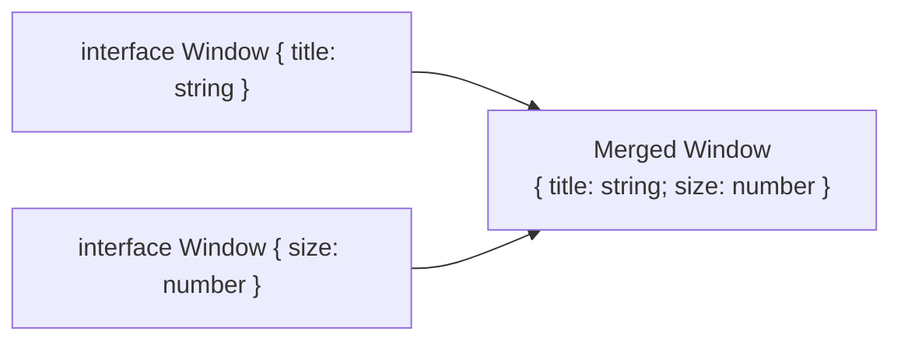
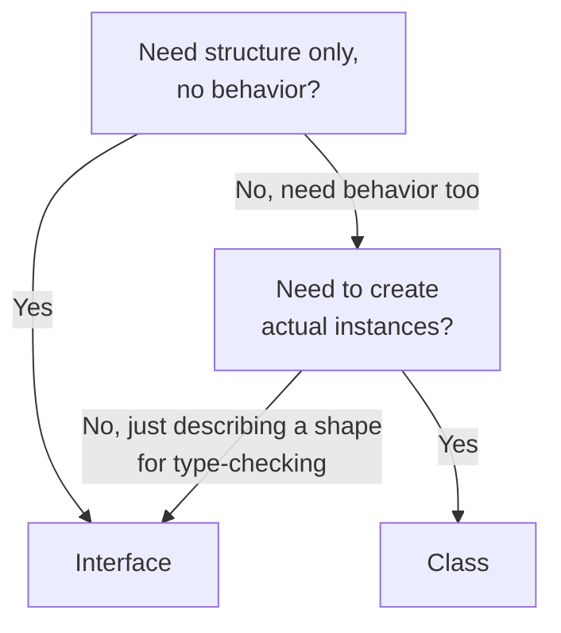
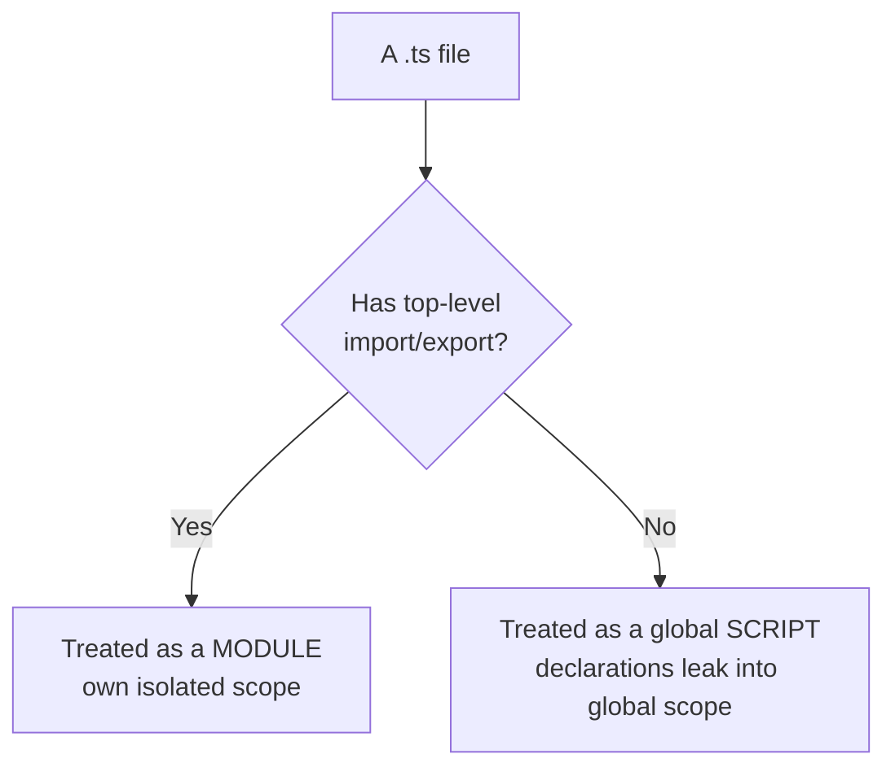

# TypeScript Interfaces & Modules — Guide

---

## 1. What is an Interface?

- A way to define the **structure** of an object — it tells the compiler exactly what properties and types an object must have.
- Acts as a contract: nothing is implemented, it only describes the **shape** data must conform to.

```typescript
interface Person {
  name: string;
  age: number;
}

const student: Person = {
  name: "John",
  age: 22,
};
```

- The `student` object is only valid if it matches the `Person` shape exactly (plus whatever optional rules apply — covered next). This checking happens entirely at compile time; interfaces leave **no trace** in the compiled JavaScript output, since they exist purely to guide the type checker.

---

## 2. Optional Properties

- Use `?` to mark a property as not strictly required.

```typescript
interface Employee {
  id: number;
  name: string;
  department?: string; // optional
}

const emp: Employee = { id: 101, name: "Alice" }; // valid without 'department'
```

- An optional property's actual type becomes `string | undefined`, not just `string` — accessing it without checking can lead to a `TypeError` at runtime if you assume it's always present. Optional chaining (`emp.department?.toUpperCase()`) is the safe way to work with it.

---

## 3. Readonly Properties

- Use `readonly` to prevent a property from being reassigned after the object is created.

```typescript
interface Book {
  readonly isbn: string;
  title: string;
}

const b1: Book = { isbn: "123-abc", title: "Learn TypeScript" };
// b1.isbn = "456-def"; // ❌ Error: Cannot assign to 'isbn' because it is read-only
```

- This restriction is **compile-time only** — it exists purely in the type checker, and has no effect once the code is compiled to plain JavaScript. It also only protects the property at the top level: if `isbn` itself were an object or array, `readonly` wouldn't stop its internal contents from being mutated — only reassigning the property itself is blocked.

---

## 4. Interface for Function Types

- Interfaces can describe a **callable signature**, not just object shapes — meaning they can define what a function itself looks like.

```typescript
interface Greet {
  (name: string): string;
}

const sayHello: Greet = (name) => {
  return `Hello, ${name}`;
};
```

- This is functionally identical to writing a type alias like `type Greet = (name: string) => string;` — the choice between `interface` and `type` here is purely stylistic, since a function-type interface can't be extended with additional object properties the way a typical interface might be used elsewhere.

---

## 5. Extending Interfaces

- Interfaces can be extended, similar to inheritance in object-oriented languages.

```typescript
interface Animal {
  name: string;
}

interface Dog extends Animal {
  breed: string;
}

const myDog: Dog = { name: "Buddy", breed: "Labrador" };
```

- Unlike a class (which only supports **single inheritance** through `extends`), an interface can extend **multiple** interfaces at once — combining several shapes into one.

```typescript
interface HasWheels {
  wheels: number;
}
interface HasEngine {
  horsepower: number;
}

interface Car extends HasWheels, HasEngine {
  brand: string;
}
```

---

## 6. Declaration Merging — A Unique Interface-Only Feature

- If you declare **two interfaces with the same name** in the same scope, TypeScript doesn't throw a conflict error — it **merges** their members into one combined interface automatically.

```typescript
interface Window {
  title: string;
}
interface Window {
  size: number;
}
// Merged result: Window now has both 'title' and 'size'
let w: Window = { title: "Main", size: 800 };
```



- This behavior is **unique to interfaces** — doing the same thing with `type` aliases (declaring the same type name twice) is a hard compile-time error, since type aliases are meant to be a single, final definition.
- The practical real-world use case: this is exactly how you'd **augment a third-party library's types** — for example, adding a custom property to Express's `Request` object, or extending the global `Window` object in the browser, without modifying the original library's source code.

---

## 7. Interfaces with Index Signatures

- For objects whose exact key names aren't known upfront (dictionary-like data), an interface can describe a general pattern instead of fixed keys.

```typescript
interface StringMap {
  [key: string]: string;
}

let countryCodes: StringMap = { India: "IN", USA: "US" };
```

---

## 8. Interface vs Type Alias

- For plain object shapes, both can describe nearly identical structures — but the mechanics underneath differ in ways that matter at scale.

| Capability | Interface | Type Alias |
|---|---|---|
| Declaration merging | Supported — redeclaring adds members | Not supported — causes an error |
| Extending | `extends` keyword | Intersection (`&`) |
| Describing unions | Cannot represent a union directly | `type Status = "a" \| "b"` |
| Aliasing primitives/tuples | Object shapes only | Can alias any type |
| Typical use | Public API contracts, extendable shapes | Unions, complex compositions |

- A practical rule: if you're defining a shape that **might need to be extended by consumers of your code** (like a library's public types), prefer `interface` — declaration merging gives consumers an escape hatch to augment it later. For everything involving unions, mapped types, or conditional logic, `type` is the only option.

---

## 9. Class vs Interface

| Feature | Class | Interface |
|---|---|---|
| Definition | Blueprint to create objects, with implementation | Defines structure/type only, no implementation |
| Contains | Properties, constructors, methods (implemented) | Only property/method **signatures** |
| Instantiation | Created using `new` | Cannot be instantiated directly |
| Inheritance | Single inheritance via `extends` | Multiple inheritance via `extends` |
| Implements | A class can implement one or more interfaces | An interface cannot implement a class |
| Access modifiers | Supports `public`, `private`, `protected` | Does not support access modifiers |

```typescript
interface Animal {
  name: string;
  sound(): void;
}

class Dog implements Animal {
  name: string;
  constructor(name: string) {
    this.name = name;
  }
  sound() {
    console.log("Woof!");
  }
}

const pet = new Dog("Tommy");
pet.sound(); // Woof!
```

- The `implements` keyword here only enforces a **compile-time contract** — it forces `Dog` to have everything `Animal` requires, but it leaves zero trace at runtime. This is different from `extends` between classes, which creates a real runtime prototype chain. An interface `implements` relationship is purely a type-checking promise, not an actual runtime connection between `Dog` and `Animal`.
- A class can implement **multiple** interfaces at once (`class Dog implements Animal, Pet { ... }`), which is how TypeScript lets you combine several independent "contracts" onto one concrete class, even though the class itself can only `extend` one parent class.

### Why does a class use `implements` for interfaces, but `extends` for other classes?

- Think of `extends` as meaning: **"inherit real, working code from this."** When a class extends another class, it inherits actual method bodies, actual property initializers — something it can genuinely build on top of and reuse.
- An interface has none of that — it's only a **shape**, a description of what properties and methods must exist, with **no implementation at all** behind any of them.
- `implements` means something different: **"I promise my class will have everything this shape requires."** It's a promise about structure, not a transfer of working code.
- Using `extends` on an interface would be misleading — there's nothing being "extended" in the sense of inherited behavior, since an interface has no behavior to give. `implements` exists specifically to keep that distinction honest.

### A twist worth knowing: an interface *can* extend a class

- While a class can never `extends` an interface, TypeScript does allow the **reverse** — an interface can `extends` a class.

```typescript
class Control {
  private state: any;
}

interface SelectableControl extends Control {
  select(): void;
}
```

- This works because, in this direction, TypeScript only needs the class's **member shape** (including private members, interestingly) — not its actual implementation. The interface simply inherits the class's type shape and adds more requirements on top, the same way it would extend another interface.
- This is a genuinely unusual, rarely-used feature — but it's a good example of why memorizing "classes relate to interfaces via `implements`" as a blanket rule isn't quite complete. The real rule is about what's being inherited (shape vs. implementation), not about which keyword "belongs" to which construct.



---

## 10. Generic Interfaces

- An interface can take a **type parameter**, making it reusable across different data types while keeping full type safety — the same motivation as generic functions, applied to object shapes.

```typescript
interface Box<T> {
  value: T;
  getValue(): T;
}

let stringBox: Box<string> = { value: "hello", getValue() { return this.value; } };
let numberBox: Box<number> = { value: 42, getValue() { return this.value; } };
```

- This is the exact pattern behind a **repository/data-access interface**, a very common real-world use case:

```typescript
interface Repository<T> {
  findById(id: number): T | undefined;
  save(item: T): void;
}

interface User { id: number; name: string; }
let userRepo: Repository<User>; // now every method is locked to User specifically
```

- Generic interfaces can also be **constrained**, just like generic functions, to require the type parameter to have certain members:

```typescript
interface Comparable<T extends { id: number }> {
  compareTo(other: T): number;
}
```

---

## 11. Hybrid Types — An Interface That's Both Callable and Has Properties

- An interface isn't limited to describing plain objects or plain functions — it can describe something that is **both at once**: a value that can be called like a function, but also carries its own properties.

```typescript
interface Counter {
  (start: number): string;   // callable signature
  interval: number;           // regular property
  reset(): void;              // regular method
}

function createCounter(): Counter {
  let counter = ((start: number) => `count: ${start}`) as Counter;
  counter.interval = 1000;
  counter.reset = () => console.log("reset");
  return counter;
}
```

- This pattern shows up in real libraries more often than it seems — a function object that also exposes utility methods or configuration properties attached directly to it (similar in spirit to how some JavaScript libraries attach helper methods onto their main exported function).

---

## 12. Recursive (Self-Referencing) Interfaces

- An interface can reference **itself** within its own definition — essential for describing naturally recursive data, like trees or nested structures.

```typescript
interface TreeNode {
  value: number;
  children: TreeNode[]; // an array of the same interface
}

let tree: TreeNode = {
  value: 1,
  children: [
    { value: 2, children: [] },
    { value: 3, children: [{ value: 4, children: [] }] },
  ],
};
```

- This is exactly how you'd type things like a comment thread with nested replies, a file-system tree, or a parsed JSON structure with arbitrary nesting.

---

## 13. Construct Signatures

- Beyond describing a callable function (Section 4), an interface can describe something callable specifically with `new` — used when you need to type something that **constructs instances**, like a class reference passed as a value (common in factory functions and dependency injection).

```typescript
interface ClockConstructor {
  new (hour: number, minute: number): ClockInstance;
}

interface ClockInstance {
  tell(): void;
}

function createClock(ctor: ClockConstructor, hour: number, minute: number): ClockInstance {
  return new ctor(hour, minute);
}
```

- This lets `createClock` accept **any class** matching that constructor shape, without hardcoding which specific class — a foundational pattern for writing factories or plugin systems that work with interchangeable class implementations.

---

## 14. The Structural Typing Exception: Private & Protected Members

- Section 9 touched on structural typing in passing, but there's a sharp, commonly-tested exception to it: structural compatibility **breaks down** once `private` or `protected` members are involved.

```typescript
class Animal {
  private name: string;
  constructor(name: string) { this.name = name; }
}

class Robot {
  private name: string;
  constructor(name: string) { this.name = name; }
}

let a: Animal = new Robot("R2D2"); // ❌ Error — even though the shapes look identical
```

- At first glance this looks like a contradiction: both classes have the exact same property name and type. But TypeScript treats a `private` (or `protected`) member as carrying an invisible "tag" tied to the **specific class declaration** it came from — not just its name and type. Two private members are only considered compatible if they both trace back to the **same declaration**, through direct identity or inheritance.
- Practically: this means `private`/`protected` members make a class partially **nominal** (checked by declared identity) rather than purely structural, even though the rest of TypeScript's type system stays structural. This is one of the few places the "TypeScript is 100% structural" generalization breaks — and it's a frequent senior-level interview trap for exactly that reason.
- `public` members don't have this restriction — two classes with only `public` members of the same shape remain freely interchangeable, as expected under normal structural typing.

---

## 15. Can a Class `implements` a Type Alias Instead of an Interface?

- Yes — as long as the type alias describes an **object shape**, a class can implement it exactly like an interface.

```typescript
type Flyable = { fly(): void };

class Bird implements Flyable {
  fly() { console.log("flying"); }
}
```

- The distinction only matters when the alias **isn't** a plain object shape — a class cannot implement a type alias that's a union (`type Status = "a" | "b"`) or a primitive alias, since there's no coherent "structure" for a class to fulfill in those cases. For plain object shapes, `implements` genuinely doesn't care whether the contract came from an `interface` or a `type`.

---

## 16. What Declaration Merging Can and Can't Do

- Merging two interface declarations with the **same name** combines all their members — but it isn't unconditional.

```typescript
interface Config {
  retries: number;
}
interface Config {
  timeout: number; // ✅ fine — new, non-conflicting property
}
// interface Config { retries: string; } // ❌ Error — conflicting type for 'retries'
```

- Properties with the **same name and same type** across merged declarations are fine; properties with the **same name but a conflicting type** cause a compile error — merging isn't a way to silently override a property's type.
- **Method** members with the same name across merged declarations behave differently from properties: instead of conflicting, they combine into **function overloads** on that method name, giving the interface multiple valid call signatures for it.

---

## 17. TypeScript Modules

### What are Modules?
- A way to **organize and encapsulate** code — splitting a large program into smaller files, with explicit control over what's shared between them.
- A TypeScript file is treated as a module **only if it contains at least one top-level `import` or `export` statement** — without either, the file is instead treated as a global script, and anything declared in it leaks into the shared global scope, risking naming collisions across files. This distinction is a common, subtle source of bugs in larger projects.



### Exporting and Importing

```typescript
// mathUtils.ts
export function add(a: number, b: number): number {
  return a + b;
}
export function subtract(a: number, b: number): number {
  return a - b;
}
```

```typescript
// main.ts
import { add, subtract } from "./mathUtils";
console.log(add(10, 5)); // 15
```

### Named Exports vs Default Exports
- A module can have **any number** of named exports (`export function ...`), imported using `{ }` with exact matching names.
- A module can have **at most one** default export (`export default ...`), imported **without** curly braces, and the importer can name it **anything** they like.

```typescript
// logger.ts
export default function log(message: string) {
  console.log(message);
}

// main.ts
import myLogger from "./logger"; // no braces, and the name doesn't need to match
```

- This naming freedom with default exports is convenient but also a tradeoff: since the imported name isn't enforced to match anything in the source file, it can make tracing a symbol back to its definition slightly less direct across a large codebase. This is one reason many style guides prefer named exports as the default choice, reserving default exports for a file's single primary export (like one main class or component per file).

### Multiple Ways to Import

**1. Named Imports (most common)**
```typescript
import { AppName, add } from "./Module";
```

**2. Aliased Imports** — rename on import, useful to avoid naming conflicts
```typescript
import { add as addNumbers, AppName as NameOfApp } from "./Module";
```

**3. Namespace Import** — import everything under one grouped object
```typescript
import * as Utils from "./Module";
console.log(Utils.add(2, 3));
console.log(Utils.AppName);
```

- Namespace imports are useful when a module has many exports you'd otherwise have to list individually, or when you want to clearly group related functionality under one namespace in your code for readability.

### A Note on Module Systems
- TypeScript doesn't define its own runtime module system — it compiles `import`/`export` syntax down to whichever module system your project actually targets, controlled by the `module` option in `tsconfig.json` (e.g. `CommonJS` for older Node.js projects, `ESNext`/`ES2020` for modern bundlers and native ES module support).
- This matters practically because CommonJS (`require`/`module.exports`) and ES Modules (`import`/`export`) have real behavioral differences — for instance, CommonJS exports are a snapshot taken at `require()` time, while ES Module exports are "live bindings" that reflect later changes in the source module. The `esModuleInterop` compiler flag exists specifically to smooth over compatibility friction between the two systems during compilation.

---

## 18. Type-Only Imports

- When you only need a type for compile-time checking — not any actual runtime value — you can mark the import as **type-only**, so TypeScript knows to strip it out entirely during compilation.

```typescript
import type { User } from "./types";

function greet(user: User): string {
  return `Hello, ${user.name}`;
}
```

- A regular `import { User }` would normally also get erased automatically if `User` is only ever used as a type — but `import type` makes this **explicit and guaranteed**, rather than relying on the compiler to figure it out.
- This matters concretely under the `isolatedModules` setting (required by many modern bundlers like esbuild or Babel, which compile each file independently without full cross-file type analysis). Those tools can't always tell on their own whether an import is type-only or not — `import type` removes the ambiguity, preventing the bundler from mistakenly trying to import a module at runtime that doesn't actually exist there (e.g. a `.ts`-only type definition file with no compiled JS counterpart).

---

## 19. Dynamic Imports

- A standard `import` statement is **static** — it's resolved entirely at compile time, and always runs when the file loads. A **dynamic import** (`import(...)`) instead loads a module **at runtime**, on demand, and returns a `Promise`.

```typescript
async function loadUtils() {
  const utils = await import("./mathUtils");
  console.log(utils.add(2, 3));
}
```

- This is the mechanism behind **code-splitting** and **lazy loading** — rather than bundling every module into one large file loaded upfront, a dynamic import lets a bundler split that module into its own chunk, fetched only when actually needed (e.g. loading a heavy chart library only when the user navigates to a page that shows a chart).
- Unlike static imports, the path passed to a dynamic import can be a **computed expression**, not just a fixed string literal — allowing conditional or data-driven module loading.

---

## 20. Module Resolution & Path Mapping

- When you write `import { add } from "./mathUtils"`, something has to decide which actual file that resolves to — this process is **module resolution**, and TypeScript's resolution strategy is configured via the `moduleResolution` option in `tsconfig.json` (common values: `node`, `bundler`, or the older `classic`).
- Beyond resolving relative paths, TypeScript supports custom import **aliases** via `baseUrl` and `paths` in `tsconfig.json` — letting you write cleaner imports like `@components/Button` instead of long relative paths like `../../../components/Button`.

```json
{
  "compilerOptions": {
    "baseUrl": ".",
    "paths": {
      "@components/*": ["src/components/*"]
    }
  }
}
```

- A genuinely common real-world gotcha: `paths` mapping is a **compile-time-only** instruction to the TypeScript type checker — it does **not** automatically make the alias resolve at runtime. If your actual runtime (Node.js, or a bundler without matching alias configuration) doesn't know about `@components/*`, you'll get a "Cannot find module" error at runtime even though `tsc` compiled the file without complaint. The bundler or runtime needs its **own**, separately configured alias mapping that mirrors the one in `tsconfig.json`.

---

## 21. Ambient Modules & Declaration Files

- Not every JavaScript library ships with TypeScript types. An **ambient module declaration** lets you describe the shape of an untyped module yourself, usually inside a `.d.ts` (declaration) file.

```typescript
// custom.d.ts
declare module "some-untyped-library" {
  export function doSomething(x: number): string;
}
```

- Once declared, importing from that module elsewhere in the project is now fully type-checked against your declaration, even though the library itself has no types.
- A common variant uses a **wildcard module pattern**, often seen in frontend projects to type non-code asset imports (like images or stylesheets) that a bundler handles specially:

```typescript
declare module "*.svg" {
  const content: string;
  export default content;
}
```

---

## 22. Module Augmentation

- This is **declaration merging (Section 6), applied across module boundaries** — letting you add new members to a type defined in a completely separate module, including one from a third-party library, without editing its source.

```typescript
// express-augment.d.ts
import "express";

declare module "express" {
  interface Request {
    user?: { id: number; name: string };
  }
}
```

- After this, every file that imports `Request` from `express` sees the augmented version with `user` included — this is exactly how many real-world Express/Node.js projects add authentication data onto the request object in a type-safe way.
- The same risk noted earlier about declaration merging applies here even more directly: since this modifies a type that many other files rely on, an unexpected shape elsewhere in a large codebase can sometimes be traced back to an augmentation file like this one — worth documenting clearly when used.

---

## 23. Namespaces vs Modules — A Legacy Distinction Worth Recognizing

- Before ES Modules were standardized, TypeScript had its own construct for organizing code: the `namespace` keyword (originally called "internal modules").

```typescript
namespace Geometry {
  export function area(radius: number): number {
    return Math.PI * radius ** 2;
  }
}

Geometry.area(5);
```

- A namespace compiles down to a plain nested JavaScript object wrapping its members — it has **no concept of separate files** the way ES modules do; multiple `namespace Geometry { ... }` blocks (even across different files) **merge together** automatically, using the same declaration-merging mechanism interfaces use.
- In modern TypeScript, namespaces are **largely discouraged** in favor of ES modules (`import`/`export`), which offer proper file-based scoping, better tooling support, and align with the rest of the JavaScript ecosystem. Namespaces still show up in: older codebases predating widespread ES module adoption, and some `.d.ts` declaration files for global libraries that don't use a module system at all.
- The key distinction to articulate clearly: a **module** is tied to a file and uses `import`/`export`; a **namespace** is a language-level grouping construct that can span multiple files and doesn't require the file to be a module at all.

---

## 24. Circular Dependencies Between Modules

- A circular dependency happens when Module A imports from Module B, and Module B also imports from Module A (directly, or through a longer chain). This is usually **not a compile error**, but it can cause confusing runtime behavior.


- Under **CommonJS**, when a circular require occurs, one of the two modules receives a **partially completed** version of the other's exports object — whichever module finishes loading second may find that some of what it imported from the first module is still `undefined`, because the first module hadn't finished executing yet when the circular `require()` happened.
- Under **ES Modules**, the situation is somewhat more resilient because of **live bindings** (mentioned earlier) — the imported reference is connected to the actual variable in the source module, so once that module finishes initializing, the importing module sees the correct final value, even if it was read earlier. However, attempting to actually *use* a value before its module has finished initializing still fails, just with a different, usually clearer error.
- Circular dependencies are generally a sign of a **structural design issue** — the practical fix is almost always extracting the shared logic both modules depend on into a separate third module that neither original module needs to import from the other.

---

## Q&A

**Q1. What is an interface in TypeScript, and does it have any presence in the compiled JavaScript?**

A:
- An interface defines the structure an object must conform to — properties, types, and method signatures, with no implementation.
- It exists purely for compile-time type checking.
- It leaves no trace in the compiled JavaScript output — interfaces are fully erased.

**Q2. What is the actual type of an optional property, and what's the risk of not accounting for it?**

A:
- An optional property (`name?: type`) is actually typed as `type | undefined`.
- Accessing it directly without checking can cause a runtime error if it happens to be missing.
- Optional chaining (`obj.prop?.method()`) is the safe way to access it without that risk.

**Q3. Does `readonly` on an interface property provide any runtime protection?**

A:
- No — it's a compile-time-only restriction enforced by the type checker.
- Once compiled to JavaScript, nothing prevents reassignment at runtime.
- It also only protects the property itself at the top level — if the value is an object, its internal contents can still be freely mutated.

**Q4. Can an interface extend more than one other interface? How does this compare to class inheritance?**

A:
- Yes — an interface can extend multiple interfaces at once, combining all their members into one shape.
- A class, by contrast, only supports single inheritance through `extends` — it can only have one direct parent class.
- A class can still combine multiple contracts by implementing multiple interfaces, even though it can only extend one class.

**Q5. What is declaration merging, and why is it unique to interfaces rather than type aliases?**

A:
- Declaration merging means declaring the same interface name more than once in the same scope automatically combines their members into a single merged interface, instead of causing an error.
- This works only for interfaces — redeclaring a `type` alias with the same name is a compile-time error, since type aliases are meant to be one final, complete definition.
- A real use case is augmenting third-party library types, like adding a custom property to Express's `Request` type, without modifying the library's own source.

**Q6. What does the `implements` keyword actually enforce, and does it create any runtime relationship between the class and the interface?**

A:
- `implements` forces the class to provide everything the interface requires, checked entirely at compile time.
- It creates no runtime connection whatsoever between the class and the interface — interfaces don't exist after compilation.
- This differs from class-to-class `extends`, which does create a real runtime prototype chain between parent and child.

**Q7. What is the key practical difference between choosing `interface` vs `type` for an object's shape?**

A:
- Interfaces support declaration merging and are conventionally used for shapes meant to be extended or augmented later, like public API contracts.
- Type aliases support unions, intersections, and aliasing non-object types directly, which interfaces cannot do.
- If extendability by others matters, prefer interface; if the type needs to represent a union or complex composition, type alias is the only option.

**Q8. What determines whether a `.ts` file is treated as a module or as a global script?**

A:
- A file is treated as a module only if it contains at least one top-level `import` or `export` statement.
- Without either, the file is treated as a global script, and anything declared inside it leaks into the shared global scope.
- This can cause naming collisions across unrelated files if a file was meant to be isolated but accidentally has no import/export statements.

**Q9. What is the difference between a named export and a default export, and what tradeoff comes with using a default export?**

A:
- A module can have multiple named exports, imported using `{ }` with names that must match exactly.
- A module can have at most one default export, imported without braces, and the importer can name it anything they like.
- The tradeoff: since the imported name isn't tied to anything in the source file, tracing a default-exported symbol back to its definition across a large codebase can be slightly less direct than with named exports.

**Q10. What is the difference between CommonJS and ES Module exports in terms of how they behave at runtime, and why does this matter in TypeScript projects?**

A:
- CommonJS (`require`/`module.exports`) exports are effectively a snapshot taken at the moment `require()` runs.
- ES Modules (`import`/`export`) use "live bindings," meaning a change to an exported value in the source module is reflected wherever it was imported, even after the initial import.
- TypeScript compiles `import`/`export` down to whichever module system is set in `tsconfig.json`'s `module` option, so the actual runtime behavior depends on that target — not just on the TypeScript syntax used.

**Q11. In a large codebase, when would you deliberately choose a namespace import (`import * as Utils`) over named imports?**

A:
- When a module exports many related functions or constants, and listing each one individually would be verbose or hard to maintain as the module grows.
- When you want to clearly group related functionality under one namespace for readability in the code that uses it.
- The tradeoff: it can make it less obvious at a glance which specific exports are actually being used, compared to an explicit named-import list.

**Q12. Why might augmenting a third-party library's types via declaration merging be considered risky, even though it's a supported feature?**

A:
- Since it relies on the library's internal type names matching exactly, an update to the library that renames or restructures those types can silently break the augmentation.
- It modifies the *apparent* shape of a type globally across the project, which can make it harder for other developers to understand where certain properties on a familiar type (like Express's `Request`) actually came from.
- It should generally be used deliberately and documented clearly, rather than as a casual workaround for a missing property.

**Q13. What is a generic interface, and give a practical example of where this pattern shows up in real applications.**

A:
- An interface that takes a type parameter, making it reusable across different data types while keeping full type safety.
- Example: `interface Repository<T> { findById(id: number): T | undefined; save(item: T): void; }`.
- Real-world use: data-access or repository patterns, where the same interface shape is reused for `Repository<User>`, `Repository<Product>`, etc., without duplicating the interface for each entity type.

**Q14. What is a hybrid type in TypeScript, and why would you need one?**

A:
- An interface that describes something both callable as a function **and** carrying its own properties/methods, combining a call signature with regular members in one type.
- Needed when modeling a value that behaves like both a function and an object at the same time — for example, a counter function that can also be configured or reset via properties attached to it.

**Q15. How would you type a recursive data structure like a tree in TypeScript?**

A:
- Define an interface that references itself within its own property types.
- Example: `interface TreeNode { value: number; children: TreeNode[]; }`.
- This pattern is used for any naturally nested structure — trees, nested comment threads, recursively nested JSON.

**Q16. What is a construct signature in an interface, and what problem does it solve?**

A:
- Syntax like `new (hour: number, minute: number): ClockInstance` inside an interface, describing something callable specifically with the `new` keyword — essentially typing a class reference itself, not an instance of it.
- Solves the problem of accepting "any class matching this shape" as a parameter, which is foundational for writing factory functions or systems that construct instances from interchangeable class implementations.

**Q17. TypeScript is usually described as structurally typed. Describe a case where that description breaks down.**

A:
- When a class has `private` or `protected` members, structural compatibility no longer applies purely based on shape.
- Two classes with identically named and typed private members are still considered incompatible unless those members trace back to the same original class declaration (through direct identity or inheritance).
- This means private/protected members introduce a partially nominal (identity-based) check into an otherwise fully structural type system — a well-known exception that catches many people off guard.

**Q18. Can a class use `implements` with a type alias instead of an interface? Are there any restrictions?**

A:
- Yes — as long as the type alias describes a plain object shape, `implements` works identically whether the contract is an `interface` or a `type`.
- The restriction: a class cannot implement a type alias that represents a union or a primitive type, since there's no single coherent structure for the class to fulfill in those cases.

**Q19. If you declare the same interface name twice with a property that has conflicting types, what happens? What about a method with the same name in both declarations?**

A:
- A property with the same name but a conflicting type across the two declarations causes a compile-time error — merging doesn't allow silently changing a property's type.
- A method with the same name in both declarations doesn't conflict the same way — instead, the two versions combine into overloads for that method, giving the interface multiple valid call signatures.

**Q20. What is the difference between a regular `import { User }` and `import type { User }`, and why does it matter for certain build tools?**

A:
- A regular named import of something only used as a type is usually also erased automatically by the compiler, but this isn't always guaranteed, especially to external tools.
- `import type` makes the type-only nature explicit, guaranteeing it's stripped at compile time.
- This matters specifically under settings like `isolatedModules`, used by bundlers that compile each file independently without full cross-file analysis — they can't always determine on their own whether an import is type-only, so `import type` removes the ambiguity and avoids accidentally generating a runtime import for something that doesn't exist at runtime.

**Q21. What is a dynamic import, and how is it different from a regular static import?**

A:
- A regular `import` is resolved at compile time and always runs when the file loads.
- A dynamic import (`import(...)`) loads a module at runtime on demand, returning a Promise, and its path can be a computed expression rather than a fixed string.
- This is the underlying mechanism for code-splitting and lazy loading — deferring loading a module until it's actually needed.

**Q22. If `tsconfig.json`'s `paths` option is correctly configured, will your import aliases automatically work at runtime? Why or why not?**

A:
- No — `paths` mapping is a compile-time-only instruction for the TypeScript type checker.
- The actual JavaScript runtime or bundler doesn't know about this mapping unless it's separately configured with a matching alias setup.
- This commonly causes a "Cannot find module" error at runtime even though `tsc` compiled without any errors, since the two tools' alias configurations aren't automatically synced.

**Q23. How would you provide type information for a JavaScript library that has no TypeScript types of its own?**

A:
- Write an ambient module declaration, typically inside a `.d.ts` file, using `declare module "library-name" { ... }` to describe its exported shape.
- Once declared, any import from that module elsewhere in the project is type-checked against your custom declaration, even though the library itself ships with no types.

**Q24. What is module augmentation, and how does it relate to declaration merging?**

A:
- Module augmentation is declaration merging applied across module boundaries — it lets you add new members to a type defined in a separate module, including a third-party library, without editing that library's source.
- A common real example: augmenting Express's `Request` interface (from the `express` module) to add a custom `user` property used after authentication middleware runs.

**Q25. What is the practical difference between a TypeScript `namespace` and an ES module, and why are namespaces considered legacy today?**

A:
- A module is tied to a file and uses `import`/`export` for explicit, file-scoped sharing.
- A namespace is a language-level grouping construct that compiles to a nested JavaScript object, can span multiple files, and merges automatically across declarations — it doesn't require the file to be a module at all.
- Namespaces predate ES modules in TypeScript's history; they're now largely discouraged in favor of ES modules, which offer proper file-based scoping and align with the broader JavaScript ecosystem, though namespaces still appear in older codebases and some global-scope declaration files.

**Q26. What's the difference in how CommonJS and ES Modules handle a circular dependency between two files?**

A:
- Under CommonJS, if two modules `require()` each other circularly, whichever module finishes loading second may receive a partially completed exports object from the other — some imported values can be `undefined` at that point.
- Under ES Modules, live bindings make this more resilient — once the source module finishes initializing, the importing module sees the correct value, even if it read the reference earlier. But actually using a value before its module finishes initializing still fails, typically with a clearer error than silent `undefined`.
- Regardless of module system, a circular dependency usually signals a structural design issue — the common fix is extracting the shared logic into a separate third module that neither original file needs to import from the other.

**Q27. Why does a class use `implements` for an interface instead of `extends`, the way it does for another class?**

A:
- `extends` means "inherit real, working code" — actual method bodies and property logic the subclass can build on.
- An interface has no implementation at all — it's only a shape describing what must exist, nothing more.
- `implements` means "I promise to match this shape," which is a statement about structure, not a transfer of working code — so using `extends` for something with no code to inherit would be misleading.

**Q28. Can an interface extend a class? If so, how is that different from a class implementing an interface?**

A:
- Yes — TypeScript allows an interface to `extends` a class, which is the reverse of the usual direction.
- This works because, in this direction, TypeScript only needs the class's member shape (including its private members) to build on — not its actual implementation, since the interface itself never needs to run any code.
- This is different from a class implementing an interface, where the class must supply real, working implementations for every member the interface declares.
