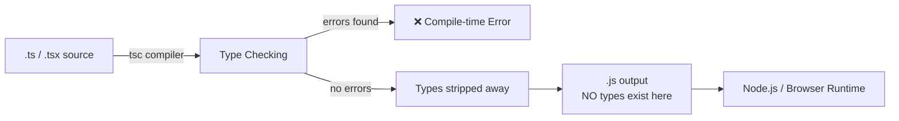
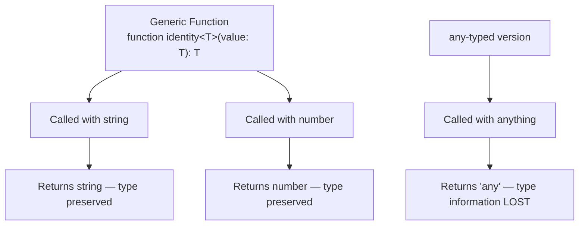

# Introduction to TypeScript — Guide

*This guide gives a full map of TypeScript. Interfaces, Modules, Classes, and Access Modifiers are covered here only at overview level — for real interview depth on those specific topics, see the dedicated guides already built for them. This guide goes deepest on Generics, Utility Types, and Advanced Type Manipulation, since those don't have a dedicated deep-dive elsewhere yet.*

---

## 1. What is TypeScript?

- Open-source language by Microsoft, first released in 2012.
- A **strict syntactical superset of JavaScript** — every valid JS program is also valid TS.
- Adds a **static type system** on top of JavaScript.
- `.ts` files don't run directly — they're compiled ("transpiled") by the TypeScript Compiler (`tsc`) into plain `.js`.



### Why do types disappear after compilation?
- This is called **type erasure** — TypeScript's entire type system exists only to catch mistakes while you write the code. Once `tsc` is satisfied, there's nothing left for a type to *do* at runtime — JavaScript itself has no concept of types to check, so keeping them around would be pointless weight in the final file.
- The practical consequence: type checking is a **development-time safety net**, not a runtime guarantee. Data coming from outside TypeScript's view — an API response, `JSON.parse()`, user input — was never actually checked, even if you confidently typed it. Trusting a type blindly for genuinely external data is a common real bug.

---

## 2. Why TypeScript Over JavaScript?

| Feature | JavaScript | TypeScript |
|---|---|---|
| Typing | Dynamic | Static (checked at compile time) |
| Error Detection | Mostly at runtime | Mostly at compile time |
| Tooling | Basic autocomplete | Rich IntelliSense, refactoring, inline docs |
| Refactoring Safety | Risky at scale | Safe — compiler flags broken references |

**The problem in JS:**
```javascript
function calculateTotal(price, quantity) {
  return price * quantity;
}
calculateTotal(10, "5"); // returns 50 due to coercion — silent bug risk
```

**The fix in TS:**
```typescript
function calculateTotal(price: number, quantity: number): number {
  return price * quantity;
}
calculateTotal(10, "5"); // ❌ compile-time error
```

### Why does `"5" + 3` even produce a weird result in plain JS?
- The `+` operator is **overloaded** in JavaScript — it means numeric addition *or* string concatenation, decided at runtime based on what the operands actually are. If either side is a string, `+` quietly switches to concatenation instead of math.
- TypeScript doesn't change how `+` works — it just forces you to be explicit about the types going into it, so this kind of silent mode-switch gets caught before it becomes a bug.

---

## 3. Setting Up TypeScript

```bash
npm install typescript --save-dev   # install
npx tsc --init                      # generate config
npx tsc index.ts                    # compile a file
npx tsc --watch                     # recompile on save
```

**Key `tsconfig.json` options:**

| Option | Purpose |
|---|---|
| `target` | JS version to compile down to (e.g. `ES2020`) |
| `strict` | Enables all strict type-checking rules |
| `module` | Module system in output (`CommonJS`, `ESNext`, etc.) |
| `outDir` | Where compiled `.js` files go |
| `rootDir` | Where compiler looks for `.ts` source |
| `esModuleInterop` | Improves CommonJS ↔ ES module compatibility |

### Why is `strict: true` recommended from day one, instead of enabling it later?
- `strict` isn't one setting — it's a bundle of several (`strictNullChecks`, `noImplicitAny`, `strictPropertyInitialization`, and more), each independently tightening what the compiler will accept.
- A codebase that grows *without* strict mode accumulates code that only works because of looser rules — untyped `any`s, unchecked `null`s, and so on. Turning strict mode on later means the compiler suddenly flags all of that at once, often hundreds of pre-existing errors across the whole project — which is exactly why "retrofitting it later is painful" in practice, not just in theory.

---

## 4. The Type System — Quick Reference

```typescript
let age: number = 30;
let username: string = "sarah_dev";
let isActive: boolean = true;
let scores: number[] = [95, 88, 76];
let coordinates: [number, number] = [12.9, 77.6]; // tuple — fixed length & order
```

| Type | Meaning |
|---|---|
| `any` | Opts out of type checking entirely — avoid |
| `unknown` | Could be anything, must be narrowed before use — the safe alternative to `any` |
| `void` | Function returns nothing |
| `never` | Function never returns (throws / infinite loop) |

```typescript
let count = 5;   // inferred as 'number'
count = "five";  // ❌ still enforced, even without an explicit annotation
```
- Use explicit typing at **function boundaries** (params, return types); let inference handle local variables.
- *Full depth on primitives, `strictNullChecks`, and `any` vs `unknown` is covered in the dedicated Data Types guide.*

---

## 5. Interfaces & Type Aliases — Overview

```typescript
interface User {
  readonly id: number;
  name: string;
  email?: string;
}

type Point = { x: number; y: number };
```

| Capability | `interface` | `type` |
|---|---|---|
| Extending | `extends`, supports declaration merging | Uses intersections (`&`) |
| Unions | ❌ Not directly | ✅ `type Status = "active" \| "inactive"` |
| Best for | Public API contracts, class shapes | Unions, complex compositions |

- Rule of thumb: `interface` for extendable objects/classes, `type` for unions and complex compositions.
- *The dedicated Interfaces & Modules guide covers this with real depth — generic interfaces, declaration merging mechanics, the structural-typing exception for private class members, and more.*

---

## 6. Functions — Advanced Typing

```typescript
function greet(name: string, greeting: string = "Hello"): string {
  return `${greeting}, ${name}!`;
}

function sum(...numbers: number[]): number {
  return numbers.reduce((total, n) => total + n, 0);
}

// Function overloading
function getValue(key: string): string;
function getValue(key: number): number;
function getValue(key: string | number): string | number {
  return typeof key === "string" ? `id-${key}` : key * 2;
}
```

### Why does overloading need a separate "implementation signature"?
- The two signatures above (`getValue(key: string): string` and `getValue(key: number): number`) aren't real, separate functions — they're just a menu of **allowed call shapes** for the type checker. Only the final signature, `(key: string | number)`, is the actual function that runs.
- This is different from true overloading in languages like Java, where multiple real methods can share a name. In TypeScript, there's only ever **one** function underneath — overload signatures exist purely so the *caller* gets a precise return type based on what they passed in, while the single implementation handles the logic for every case internally.

---

## 7. Classes & Access Modifiers — Overview

```typescript
abstract class Employee {
  protected constructor(
    public readonly id: number,
    private baseSalary: number
  ) {}
  abstract calculateBonus(): number;
  getSalary(): number {
    return this.baseSalary + this.calculateBonus();
  }
}

class Manager extends Employee {
  constructor(id: number, baseSalary: number, private teamSize: number) {
    super(id, baseSalary);
  }
  calculateBonus(): number {
    return this.teamSize * 500;
  }
}
```

| Modifier | Accessible From |
|---|---|
| `public` (default) | Anywhere |
| `private` | Only within the declaring class |
| `protected` | The class and its subclasses |
| `readonly` | Set once, in constructor, never reassigned |

- Constructor shorthand (`public readonly id: number`) auto-declares and assigns the property — removes boilerplate.
- *The dedicated Class Members guide and Inheritance guide cover this in full depth — why `private` is compile-time-only vs JS's real runtime `#private` fields, `super()` mechanics, the `override` keyword, static members, and the Singleton pattern.*

---

## 8. Generics — Reusable, Type-Safe Code

### Why generics exist — the problem they actually solve
- Without generics, a function that needs to work with "any type" has only one option: type it as `any`. But `any` doesn't just allow flexibility — it **throws away** all type information. Once a value passes through an `any`-typed function, the compiler has no idea what type comes out the other end.
- Generics solve this by using a **type variable** — a placeholder type, filled in at the moment the function is actually called — so the function stays flexible, but the *specific* type is tracked and preserved the whole way through.



```typescript
function identity<T>(value: T): T {
  return value;
}
identity<string>("hello"); // T = string, return type is string
identity<number>(42);      // T = number, return type is number

function anyIdentity(value: any): any {
  return value;
}
let result = anyIdentity("hello"); // result is typed 'any' — no autocomplete, no safety
```

### Generic constraints — restricting what `T` can be
- By default, `T` could be literally anything, which means you can't safely assume it has *any* properties or methods. A constraint (`extends`) narrows this down to types that guarantee certain members exist.

```typescript
function logLength<T extends { length: number }>(item: T): void {
  console.log(item.length); // safe — T is guaranteed to have 'length'
}
logLength("hello");   // ✅ strings have .length
logLength([1, 2, 3]); // ✅ arrays have .length
// logLength(42);      // ❌ numbers don't have .length
```

### Multiple type parameters
- A function or type can take more than one independent type variable at once.

```typescript
function merge<T, U>(a: T, b: U): T & U {
  return { ...a, ...b };
}
let combined = merge({ name: "Alice" }, { age: 25 }); // { name: string } & { age: number }
```

### Default type parameters
- A generic can specify a fallback type, used if the caller doesn't explicitly provide one.

```typescript
interface ApiResponse<T = unknown> {
  data: T;
  status: number;
}
let response: ApiResponse; // T defaults to 'unknown' if nothing is specified
```

### Generic classes and interfaces — reusable, type-safe containers
```typescript
class Box<T> {
  constructor(private contents: T) {}
  getContents(): T {
    return this.contents;
  }
}
let stringBox = new Box<string>("hello"); // locked to string for this instance
```
- This pattern — generic classes acting as typed containers — is the backbone of real-world API clients, data-access/repository layers, and testing utilities (Playwright's `Page`, `Locator`, and fixture types rely on generics internally).

---

## 9. Union Types, Intersection Types & Narrowing

```typescript
type Status = "pending" | "success" | "error"; // union — one of several values

type Timestamped = { createdAt: Date };
type Named = { name: string };
type Entity = Timestamped & Named;               // intersection — combines shapes
```

**Discriminated unions:**
```typescript
type Shape =
  | { kind: "circle"; radius: number }
  | { kind: "rectangle"; width: number; height: number };

function area(shape: Shape): number {
  switch (shape.kind) {
    case "circle": return Math.PI * shape.radius ** 2;   // narrowed
    case "rectangle": return shape.width * shape.height; // narrowed
  }
}
```
- The `kind` field is a **discriminant** — TS uses it to narrow the union inside each `case`, giving full autocomplete and type safety per branch, instead of scattering several optional fields across one flat type.

---

## 10. Utility Types — and How They Actually Work

Utility types aren't special, hardcoded magic — every one of them is just a **mapped type** (covered properly in Section 11) that TypeScript ships with built in. Understanding what's underneath each one means you're never stuck if you need a variant that doesn't exist yet.

```typescript
interface Product {
  id: number;
  name: string;
  price: number;
  description: string;
}

type ProductPreview = Pick<Product, "id" | "name">;
type ProductUpdate  = Partial<Product>;
type ProductSummary = Omit<Product, "description">;
type ProductMap     = Record<number, Product>;
type ReadonlyProduct = Readonly<Product>;
```

| Utility | What it does | What it actually looks like underneath |
|---|---|---|
| `Partial<T>` | Makes all properties optional | `{ [K in keyof T]?: T[K] }` |
| `Required<T>` | Makes all properties mandatory | `{ [K in keyof T]-?: T[K] }` — the `-?` **removes** the optional marker |
| `Readonly<T>` | Makes all properties immutable | `{ readonly [K in keyof T]: T[K] }` |
| `Pick<T, K>` | Selects a subset of properties | Loops only over the keys in `K`, keeping their original types |
| `Omit<T, K>` | Excludes a subset of properties | Built from `Pick`, selecting every key **except** the ones in `K` |
| `Record<K, V>` | Builds object type with keys `K`, values `V` | `{ [P in K]: V }` |
| `ReturnType<T>` | Extracts a function's return type | Uses the `infer` keyword inside a conditional type (Section 11) |

- The `-?` and `+?` modifiers (seen in `Required<T>`'s definition) can explicitly **add or remove** `?` or `readonly` when building a mapped type — by default, a mapped type just copies the original modifiers, but `-?`/`-readonly` let you deliberately strip them instead.

---

## 11. Advanced Type Manipulation

### `keyof` and `typeof`
```typescript
interface User { id: number; name: string; }
type UserKeys = keyof User;   // "id" | "name"

const config = { retries: 3, timeout: 5000 };
type Config = typeof config;  // { retries: number; timeout: number }
```
- `keyof` turns an object type's property names into a union of string literal types — useful for writing functions that must only accept a real, valid key of that object.
- `typeof` (in a **type position**, not a value position) reverses the direction — it takes an existing *value* and derives a *type* from it, useful when you don't want to write out a type by hand that already matches something you've defined as a plain object.

### Mapped Types — with modifiers
```typescript
type Optional<T> = { [K in keyof T]?: T[K] };       // adds '?' to every property
type Mandatory<T> = { [K in keyof T]-?: T[K] };      // removes '?' from every property
type Locked<T> = { readonly [K in keyof T]: T[K] };  // adds 'readonly' to every property
```
- A mapped type loops over every key of an existing type (`keyof T`) and rebuilds a new type, optionally changing each property's modifiers (`?`, `readonly`) along the way. This single mechanism is what powers nearly every utility type in Section 10.

### Conditional Types
```typescript
type IsString<T> = T extends string ? "yes" : "no";
type A = IsString<string>; // "yes"
type B = IsString<number>; // "no"
```
- Evaluates like a ternary, but at the **type level** — `T extends U ? X : Y` picks between two types based on whether `T` is assignable to `U`.

### The `infer` keyword — extracting a type from inside another type
- `infer` can only be used inside a conditional type, and it lets you **capture** a piece of a type you're checking against, instead of just testing it.

```typescript
type UnwrapPromise<T> = T extends Promise<infer U> ? U : T;

type A = UnwrapPromise<Promise<string>>; // string — captured from inside the Promise
type B = UnwrapPromise<number>;           // number — not a Promise, returned as-is
```
- This is exactly how TypeScript's built-in `ReturnType<T>` works internally:
```typescript
type MyReturnType<T> = T extends (...args: any[]) => infer R ? R : never;
```
- Without `infer`, you could only ask "does this type match this shape?" — `infer` lets you also ask "and if it does, grab the specific part I care about."

### Template Literal Types
- Combine string literal types the same way you'd combine strings at runtime with a template literal — but entirely at the type level.

```typescript
type Direction = "up" | "down";
type EventName = `on${Capitalize<Direction>}`; // "onUp" | "onDown"
```
- This is genuinely used in real codebases to type things like CSS-in-JS property names, strongly-typed event names, or API route strings — generating a whole family of valid string literal types from a smaller set of pieces, instead of writing each one out by hand.

---

## 12. Modules — Overview

```typescript
// mathUtils.ts
export function add(a: number, b: number): number { return a + b; }
export const PI = 3.14159;

// app.ts
import { add, PI } from "./mathUtils";
```
- Each file with a top-level `import`/`export` is its own module scope.
- Prefer **named exports** for utilities; use **default exports** sparingly.
- *The dedicated Interfaces & Modules guide covers this with real depth — type-only imports, dynamic imports, module resolution and path mapping, ambient module declarations, module augmentation, namespaces vs modules, and circular dependency behavior.*

---

## 13. TypeScript in Real Projects

| Environment | Why TypeScript Helps |
|---|---|
| Node.js / Express APIs | Typed request/response bodies, safer route refactors |
| React | Typed props/state catch UI bugs before render |
| Playwright | Typed `Page`, `Locator`, fixture objects — full autocomplete, catches broken Page Object references at compile time |

```typescript
import { Page, Locator } from "@playwright/test";

export class LoginPage {
  private readonly usernameInput: Locator;
  constructor(private page: Page) {
    this.usernameInput = page.locator("#username");
  }
  async login(username: string, password: string): Promise<void> {
    await this.usernameInput.fill(username);
  }
}
```

---

## 14. Best Practices — and Why Each One Matters

- **Enable `strict` mode from day one** — retrofitting it later means surfacing every previously-hidden issue at once, across the whole codebase.
- **Avoid `any`** — it's contagious; once it flows into other code, type safety silently disappears downstream too, often far beyond where the `any` was first written.
- **Type function boundaries explicitly, let inference handle local variables** — inference can only work with what a function *currently* does, not what it's *supposed* to accept or return.
- **Prefer discriminated unions over scattered optional flags** — a `kind` field lets the compiler narrow and check every branch; five loose optional booleans don't give the compiler any way to know which combinations are actually valid.
- **Use utility types instead of duplicating interfaces** — every hand-duplicated near-identical interface is a second place that can silently drift out of sync with the original.
- **Keep types close to their domain** — a single giant `types.ts` file becomes a merge-conflict magnet and loses any sense of which types belong together.
- **Treat every `tsc` error as a real bug** — silencing one with `as any` or `// @ts-ignore` doesn't fix the underlying issue, it just hides it from the one tool built to catch it.

---

## Q&A

**Q1. What is type erasure, and why does it matter when working with external data like an API response?**

A:
- Type erasure means all of TypeScript's type annotations are stripped out during compilation, leaving no type information in the final JavaScript.
- Since nothing is actually checking types at runtime, data that was never statically analyzed — like an API response — can be labeled with a type that doesn't actually match the real data.
- Trusting a type blindly for external data is a common source of real bugs; runtime validation is still needed for anything that didn't originate from TypeScript-checked code.

**Q2. Why does `"5" + 3` behave differently from `"5" - 3` in JavaScript, and how does TypeScript help here?**

A:
- The `+` operator is overloaded — if either operand is a string, it performs concatenation instead of numeric addition.
- The `-` operator has no string-based meaning, so JavaScript instead tries to coerce the string into a number.
- TypeScript doesn't change this behavior, but it forces explicit typing on both operands, catching an accidental mismatch before it silently produces the "wrong" kind of result.

**Q3. Why is it recommended to enable `strict: true` from the very start of a project rather than adding it later?**

A:
- `strict` bundles several independent checks together, each tightening what the compiler accepts.
- A codebase built without strict mode accumulates code that only compiles because of the looser rules — untyped values, unchecked nulls, and so on.
- Turning strict mode on later surfaces all of that accumulated looseness at once, often as a large wave of new errors across the whole project.

**Q4. Why does TypeScript need generics at all — why not just use `any` for a function that should work with multiple types?**

A:
- `any` disables type checking entirely — once a value passes through an `any`-typed function, the compiler loses track of what type it actually is.
- Generics use a type variable that gets filled in at the moment the function is called, keeping the function flexible while still preserving and tracking the specific type all the way through.
- With generics, calling a function with a `string` still gives you back a known `string`, with full autocomplete and safety — `any` gives you back nothing but `any`.

**Q5. What is a generic constraint, and why is it needed?**

A:
- A constraint (`T extends SomeShape`) restricts what types are allowed to fill in a generic's type variable.
- Without one, `T` could be anything, so the compiler can't assume it has any particular properties or methods.
- A constraint like `T extends { length: number }` guarantees every type used for `T` has a `.length` property, making it safe to access inside the function.

**Q6. What does `Partial<T>` actually look like underneath, and why does `Required<T>` need a `-?` in its definition?**

A:
- `Partial<T>` is really just the mapped type `{ [K in keyof T]?: T[K] }`, which loops over every key of `T` and adds an optional marker.
- `Required<T>` needs to do the opposite — remove any existing optional markers rather than just not adding one — which is what `-?` explicitly does.
- Without `-?`, there would be no way to express "strip optionality" through a mapped type, only "add it" or "leave it as-is."

**Q7. What is the difference between `keyof` and `typeof` in TypeScript's type system?**

A:
- `keyof` takes an existing type and produces a union of its property names as string literal types.
- `typeof`, used in a type position, takes an existing value and derives a type from it.
- They're often used together — `typeof` to get a type from a plain object, then `keyof` on that result to get its key names.

**Q8. What is the `infer` keyword, and what problem does it solve that a plain conditional type can't?**

A:
- A plain conditional type can only test whether one type is assignable to another, returning one of two fixed outcomes.
- `infer` lets you capture a specific piece of the type being checked, if the match succeeds, instead of just confirming a yes/no result.
- Example: `T extends Promise<infer U> ? U : T` doesn't just check if `T` is a Promise — it also pulls out the specific type the Promise resolves to.

**Q9. How does TypeScript's built-in `ReturnType<T>` utility actually work internally?**

A:
- It's a conditional type that checks whether `T` matches a callable function shape.
- If it does, it uses `infer R` to capture whatever that function's return type is, and returns `R`.
- If `T` isn't a function at all, it falls back to `never`, since there's no return type to extract.

**Q10. What are template literal types, and give a practical example of when they'd be used.**

A:
- They combine string literal types together the same way a runtime template literal combines strings, but entirely at the type level.
- Example: `type EventName = \`on${Capitalize<Direction>}\`` can generate `"onUp" | "onDown"` from a smaller `Direction` union automatically.
- Practical use: generating a whole family of valid string literal types (event names, CSS property variants, API route strings) from a smaller set of building-block types, instead of writing each one out manually.

**Q11. Why is `any` described as "contagious," and what's the practical risk of using it even in one small place?**

A:
- Once a value typed `any` flows into other variables or function calls, type checking is disabled for everything downstream that touches it too — even code that was otherwise fully typed.
- This means a single `any` can silently undermine type safety across a much larger portion of the codebase than it first appears to affect.
- The safer default when a type genuinely isn't known upfront is `unknown`, which forces narrowing before use instead of skipping checks entirely.

**Q12. Why is `Omit<T, K>` typically defined in terms of `Pick<T, K>` rather than built independently?**

A:
- `Pick<T, K>` already solves "keep only these keys."
- `Omit<T, K>` just needs "keep every key except these," which can be expressed as picking all the keys of `T` other than the ones in `K` — reusing the same underlying mechanism rather than writing a separate one from scratch.
- This is a common pattern in TypeScript's own utility type definitions: build new utilities out of simpler ones instead of duplicating logic.